# 🎓 End-to-End Placement Prediction & Fairness Dashboard

> A complete, reproducible machine-learning project that **predicts campus placement**, **audits the model for bias**, **mitigates it**, and uses **Generative AI (Claude)** to explain predictions and fairness results in plain English, all inside an interactive dashboard.

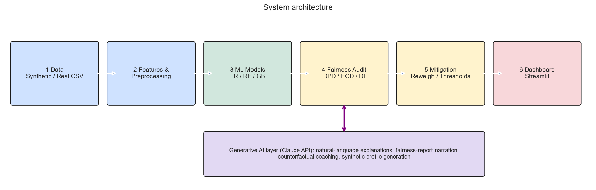

---

## 📑 Table of Contents
1. [Problem statement & motivation](#1-problem-statement--motivation)
2. [Key features](#2-key-features)
3. [Project structure](#3-project-structure)
4. [Quick start](#4-quick-start)
5. [Dataset](#5-dataset)
6. [Exploratory data analysis](#6-exploratory-data-analysis)
7. [Modelling](#7-modelling)
8. [Fairness audit](#8-fairness-audit)
9. [Bias mitigation](#9-bias-mitigation)
10. [Generative AI layer](#10-generative-ai-layer)
11. [Dashboard](#11-dashboard)
12. [Results summary](#12-results-summary)
13. [Honest limitations](#13-honest-limitations)
14. [Step-by-step guide to build/extend it yourself](#14-step-by-step-guide-to-buildextend-it-yourself)
15. [Viva / interview questions](#15-viva--interview-questions)
16. [Future work](#16-future-work)
17. [References](#17-references)

---

## 1. Problem statement & motivation

Placement cells increasingly use ML to shortlist or predict outcomes for students. If historical data contains bias (for example, men or urban students were hired more often at the same skill level), a model trained on it **learns and amplifies** that bias.

**Goal:** build a pipeline that
1. predicts whether a student will be placed,
2. measures whether the predictions are fair across gender, region and family income,
3. reduces unfairness while keeping accuracy,
4. explains everything in language a student or placement officer understands (Generative AI).

---

## 2. Key features

| Layer | What it does |
|---|---|
| **Data** | Synthetic 4,000-student dataset with a *deliberately planted* historical bias, so we know the ground truth |
| **ML** | Logistic Regression, Random Forest, Gradient Boosting, ROC/F1/accuracy comparison |
| **Fairness** | Demographic parity, equal opportunity, disparate impact (4/5ths rule), intersectional groups (gender × region) |
| **Mitigation** | Remove protected features, **Reweighing** (pre-processing), **group thresholds** (post-processing) |
| **Generative AI** | Student-level explanations, "what-if" coaching, fairness-report narration, data chat, synthetic profile generation |
| **Dashboard** | 5-tab Streamlit app |

---

## 3. Project structure

```
placement-fairness/
├── README.md
├── requirements.txt
├── app.py                      # Streamlit dashboard
├── data/
│   ├── placement_data.csv      # generated dataset
│   └── test_predictions.csv    # held-out predictions used by dashboard
├── models/final_model.joblib   # trained pipelines
├── reports/
│   ├── metrics.json
│   ├── scenario_results.csv    # fairness x accuracy for 4 scenarios
│   └── figures/*.png           # every graph in this README
└── src/
    ├── data_gen.py             # synthetic data + planted bias
    ├── fairness.py             # metrics + reweighing + thresholds
    ├── pipeline.py             # train, audit, mitigate, make all figures
    └── genai.py                # Claude API layer (with offline fallback)
```

---

## 4. Quick start

```bash
# 1. environment
python -m venv venv && source venv/bin/activate        # Windows: venv\Scripts\activate
pip install -r requirements.txt

# 2. run the whole ML + fairness pipeline (regenerates data, models, figures)
PYTHONPATH=src python src/pipeline.py                  # Windows PowerShell: $env:PYTHONPATH="src"; python src/pipeline.py

# 3. (optional) turn on Generative AI
export ANTHROPIC_API_KEY="sk-ant-..."                  # without it, templated explanations are used

# 4. launch the dashboard
streamlit run app.py
```

> **No API key?** Everything still works. `genai.py` falls back to deterministic templates, so you can demo offline.

---

## 5. Dataset

`src/data_gen.py` creates 4,000 students (overall placement rate ≈ 64 %).

| Group | Columns |
|---|---|
| **Merit features** | `cgpa`, `aptitude_score`, `communication`, `internships`, `projects`, `certifications`, `backlogs`, `branch`, `college_tier` |
| **Protected attributes** | `gender`, `region` (Urban/Rural), `family_income` (Low/Mid/High) |
| **Targets** | `placed` (0/1), `salary_lpa` |

**Planted bias.** Placement probability = *merit* + *bias term*, where the bias term gives extra advantage to male, urban and high-income students **independent of skill**. Because we wrote the generator, we can verify that the audit catches it.

> 🔁 **Using real data?** Replace `generate()` with `pd.read_csv(...)` (e.g. the public Kaggle "Campus Recruitment" dataset) and keep the column names.

---

## 6. Exploratory data analysis

### 6.1 Placement rate differs sharply by group
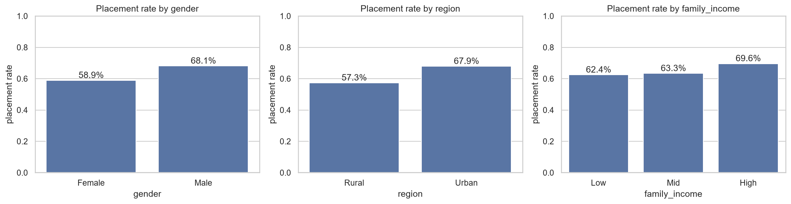

Males are placed ~9 points more often than females, and urban students ~11 points more than rural ones. That is the historical bias a naive model will inherit.

### 6.2 Correlations
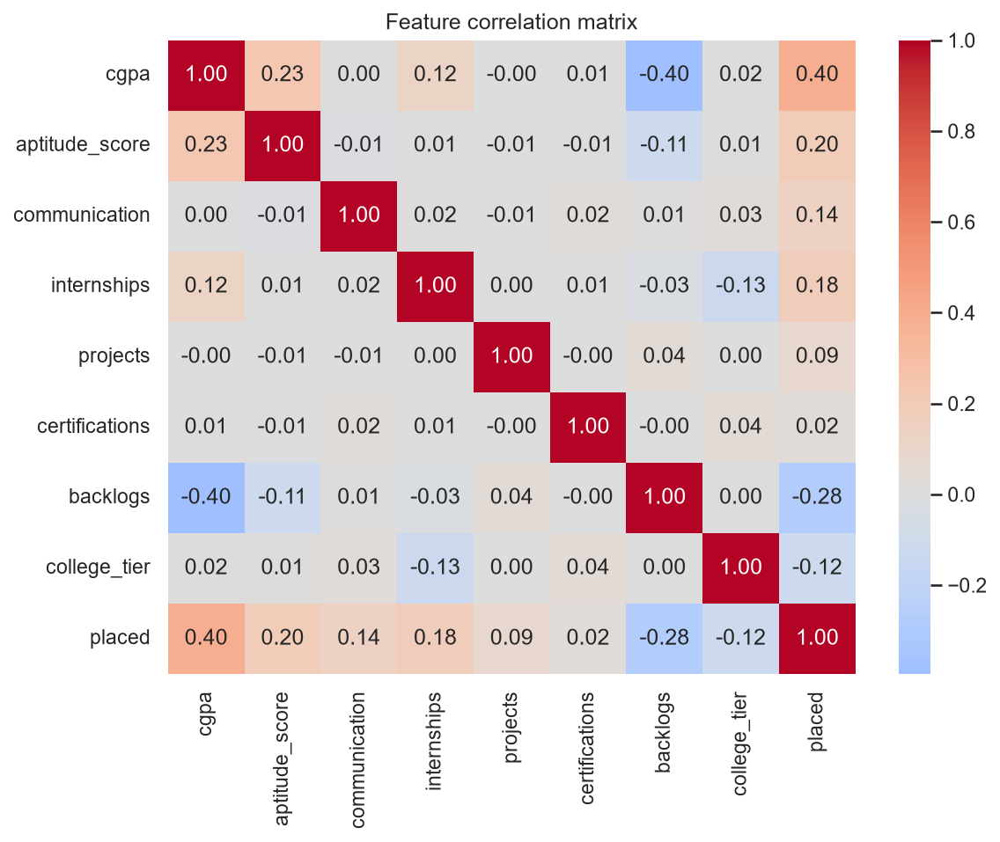

CGPA, internships and aptitude correlate positively with placement; backlogs correlate negatively.

### 6.3 Distributions
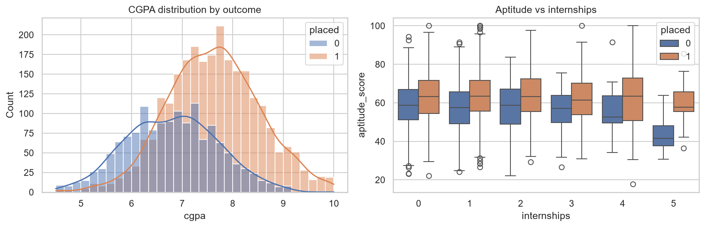

---

## 7. Modelling

Train/test split: 70/30, stratified. Preprocessing: `StandardScaler` for numerics and `OneHotEncoder` for categoricals inside a scikit-learn `Pipeline` (prevents leakage).

| Model | Accuracy | F1 | ROC-AUC |
|---|---|---|---|
| Logistic Regression | 0.772 | 0.833 | 0.816 |
| Random Forest | 0.766 | 0.834 | 0.806 |
| Gradient Boosting | 0.758 | 0.824 | 0.812 |

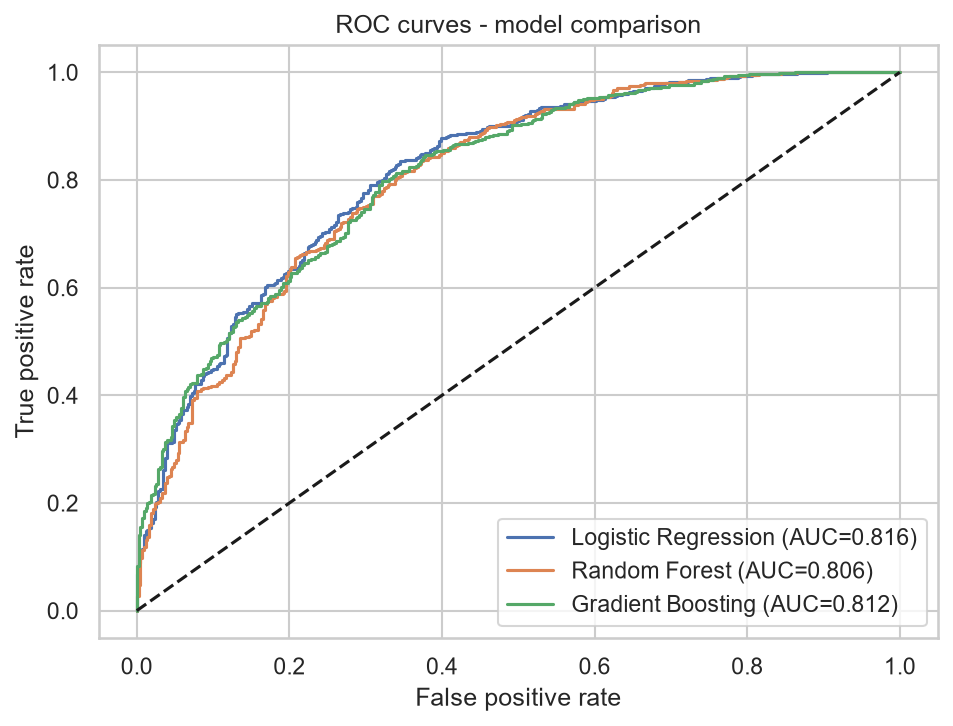

All models perform similarly (AUC ≈ 0.81). We use **Gradient Boosting** for the fairness experiments because it is a realistic, flexible model that can pick up subtle proxies.

### Does the model use protected attributes?
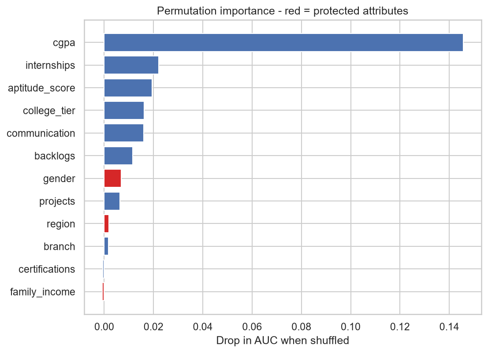

Red bars are protected attributes. The baseline model **does** rely on them. It has learnt the bias.

---

## 8. Fairness audit

### Metrics used

| Metric | Formula | Fair when |
|---|---|---|
| **Demographic parity difference** | max(selection rate) − min(selection rate) | ≈ 0 |
| **Disparate impact ratio** | min(rate) / max(rate) | ≥ 0.80 (US EEOC "4/5ths rule") |
| **Equal opportunity difference** | gap in true-positive rate between groups | ≈ 0 |

We audit single attributes **and the intersection** (gender × region), since bias often compounds: a rural woman can be disadvantaged more than either label shows alone.

### Baseline model (uses protected attributes)

| Group (test set) | n | Selection rate | TPR |
|---|---|---|---|
| Female_Rural | 180 | **56.1 %** | 74.0 % |
| Female_Urban | 325 | 74.2 % | 87.5 % |
| Male_Rural | 236 | 69.9 % | 89.6 % |
| Male_Urban | 459 | **81.3 %** | 92.5 % |

Disparate impact = **0.69 → FAILS** the 0.80 rule. Equally qualified rural women are rejected far more often.

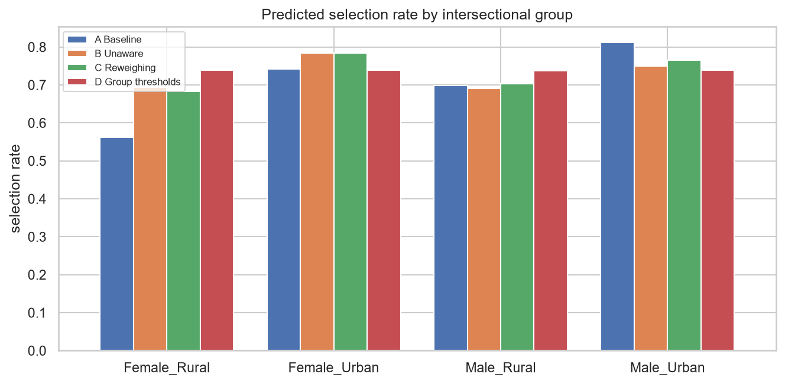

### Is it hiding in proxy features?
We trained a classifier to predict each protected attribute from the "neutral" features only:

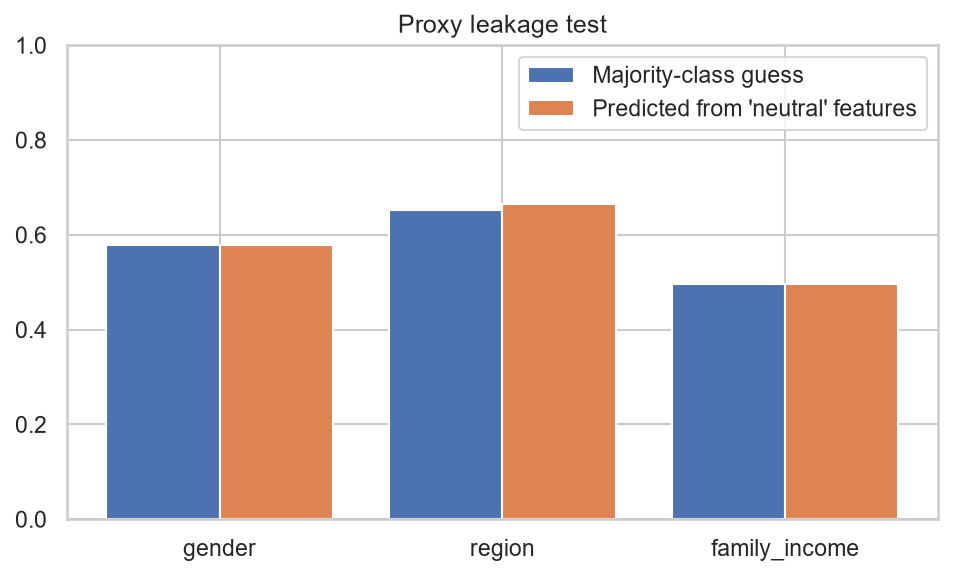

| Attribute | Majority guess | From neutral features |
|---|---|---|
| gender | 57.9 % | 57.9 % |
| region | 65.3 % | 66.5 % |
| family income | 49.6 % | 49.6 % |

Leakage is minimal for gender and income, and slight for region (via `communication`). Removing the protected columns therefore helps a lot, but **a small region effect can remain**.

---

## 9. Bias mitigation

| Scenario | Technique | Idea |
|---|---|---|
| **A. Baseline** | none | sees gender/region/income |
| **B. Unaware** | drop protected columns | "fairness through unawareness" |
| **C. Reweighing** | *pre-processing* (Kamiran & Calders 2012) | weight each (group, label) so group and outcome are statistically independent in training |
| **D. Group thresholds** | *post-processing* | pick a different score cut-off per group so selection rates match |

### Results (test set, gender × region groups)

| Scenario | Accuracy | AUC | Parity gap ↓ | Disparate impact ↑ | Equal-opp gap ↓ |
|---|---|---|---|---|---|
| A. Baseline | 0.758 | 0.812 | 0.252 | **0.690 ❌** | 0.185 |
| B. Unaware | 0.768 | 0.814 | 0.094 | 0.880 ✅ | 0.053 |
| C. Reweighing | 0.768 | 0.813 | 0.101 | 0.871 ✅ | 0.043 |
| D. Group thresholds | 0.756 | 0.814 | **0.002** | 0.998 ✅ | 0.039 |

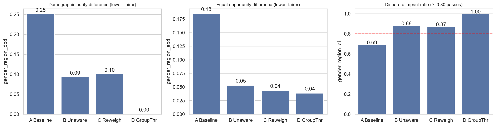

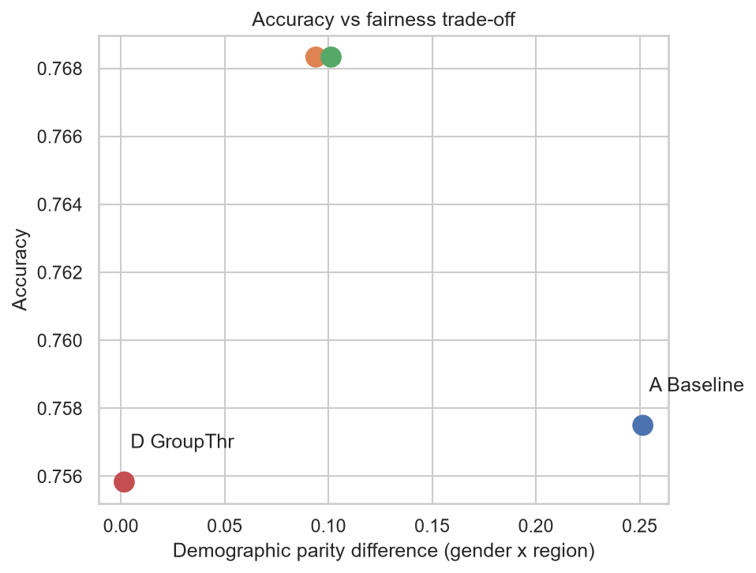

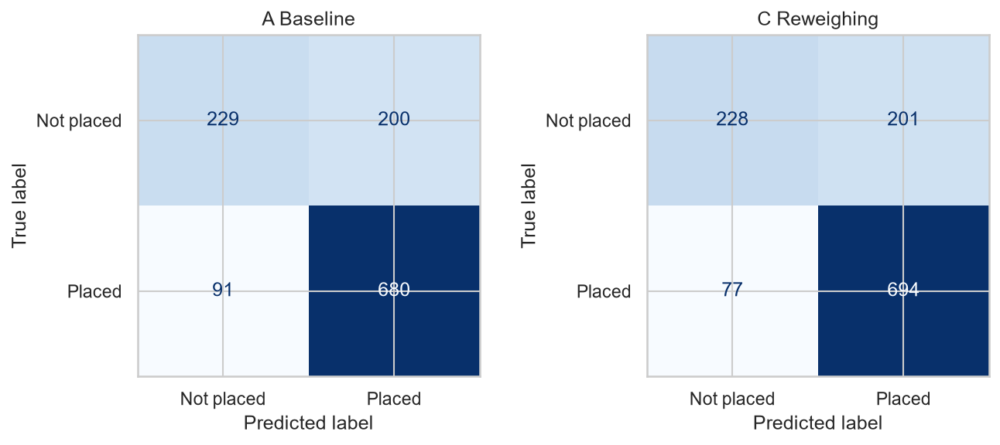

### How to read this
- Dropping protected attributes (B) and reweighing (C) cut the parity gap from **0.25 to about 0.10**, and the model now passes the 4/5ths rule with **no loss of accuracy** (apparent accuracy even rises slightly because the baseline was fitting biased noise).
- Reweighing (C) gives the best equal-opportunity gap among the "treat everyone the same" methods.
- Group thresholds (D) reach near-perfect parity for ~1 point of accuracy, **but** use group-specific cut-offs, which is *disparate treatment* and can be legally restricted. Treat D as an analysis tool, or use it only where policy and law allow.
- The saved production model is **C (Reweighing, no protected inputs)**.

> ⚠️ Accuracy is measured against *biased historical labels*, so "accuracy" partially rewards reproducing the bias. This is why fairness cannot be judged by accuracy alone.

---

## 10. Generative AI layer

`src/genai.py` calls the Claude API (`ANTHROPIC_API_KEY`; model configurable via `CLAUDE_MODEL`). **The LLM never makes the prediction.** It only verbalises facts computed by the ML code, which reduces hallucination.

| Feature | Input (grounded facts) | Output |
|---|---|---|
| **Student explainer** | probability, top counterfactual drivers, what-if gains | friendly 120-word mentor note with 2 next steps |
| **Fairness narrator** | group selection rates + metrics | audit summary with pass/fail and 3 recommendations |
| **Data chat** | JSON summary of results | answers to questions like "which group is worst off?" |
| **Synthetic profiles** | schema + ranges | fictional JSON students for demos/testing/augmentation |

### Safety design (important for a fairness project)
1. System prompts forbid mentioning or inferring gender, region or income.
2. The LLM may only use the numbers passed in ("use ONLY the facts provided").
3. What-if advice uses only **actionable** features (internships, certifications, projects, backlogs), never protected ones.
4. If the API fails, the app falls back to templates instead of crashing.

Example output (offline template mode, no API key):

```
Predicted placement chance: 88%.
Strengths: internships, CGPA. Held back by: backlogs.
Biggest realistic lever: clear 1 backlogs (≈ +2.7% chance). Protected attributes were not used in this prediction.
```

---

## 11. Dashboard

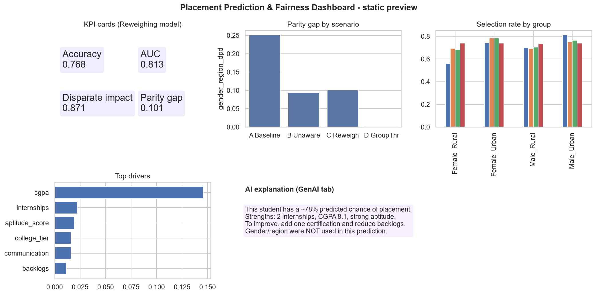

*(Static preview of the layout. Run `streamlit run app.py` for the live version.)*

| Tab | Purpose |
|---|---|
| **Overview** | KPIs, placement rate by any attribute, model comparison |
| **Predict a student** | sliders → probability, driver chart, GenAI explanation |
| **Fairness audit** | choose group + model → metrics, group table, GenAI narrative |
| **Mitigation lab** | compare scenarios A–D, trade-off plot |
| **GenAI assistant** | chat with results, generate synthetic profiles |

---

## 12. Results summary

- Historical data shows a **~9-pt gender gap** and **~11-pt region gap** at equal skill levels.
- The baseline model reproduces it: disparate impact **0.69 (fail)**, with rural women worst off (56 % vs 81 % for urban men).
- Removing protected inputs / reweighing lifts disparate impact to **≈ 0.87 (pass)** at equal or better accuracy (≈ 77 %).
- Remaining gap: mostly region, driven by legitimate-looking features such as communication rating that themselves reflect unequal opportunity. This is a *structural* issue that ML alone cannot fix and needs policy (training programs, outreach).

---

## 13. Honest limitations
- **Synthetic data**: shows the method works, but real data will be messier. Validate on real data before any real use.
- **Single random split**: no confidence intervals. Add cross-validation or bootstrap for rigor.
- **Fairness definitions conflict**: you generally cannot satisfy demographic parity, equal opportunity and calibration simultaneously.
- **Binary attributes only** in the intersection analysis; real identities are richer.
- **LLM text** is fluent but must not be treated as an authoritative explanation; it is a narration of computed numbers.
- This system should **support human decisions, never automate rejections**.

---

## 14. Step-by-step guide to build/extend it yourself

**Week 1: Data & EDA**
1. Run `src/data_gen.py`; open the CSV; write 5 observations about the groups.
2. Reproduce Figure 1 yourself with seaborn.

**Week 2: Modelling**
3. Build a `Pipeline` with `ColumnTransformer` (avoid leakage).
4. Compare 3 models; add cross-validation (`cross_val_score`) and hyper-parameter tuning (`GridSearchCV`).

**Week 3: Fairness**
5. Implement the three metrics by hand (see `fairness.py`) and verify against `fairlearn` (`pip install fairlearn`).
6. Audit intersections. Plot selection rate per group.

**Week 4: Mitigation**
7. Implement reweighing and group thresholds; try `fairlearn.reductions.ExponentiatedGradient` as an in-processing method.
8. Plot the accuracy-vs-fairness trade-off.

**Week 5: Generative AI**
9. Get an API key, set `ANTHROPIC_API_KEY`, test `genai.explain_student`.
10. Write a prompt-evaluation script: 20 profiles, check that no output mentions gender/region (automatic regex test).

**Week 6: Dashboard & report**
11. Run Streamlit, add a "download audit PDF" button, deploy on Streamlit Community Cloud.
12. Write the report: problem → method → results → limitations → ethics.

### Tips for a great demo
- Open with Figure 1 (the bias), then the baseline failing the 4/5ths rule, then the fix.
- Show the same student with and without GenAI explanation.
- Proactively mention limitations (section 13). Evaluators reward honesty.

---

## 15. Viva / interview questions

1. *Why not just delete gender and region?* Proxies can leak it; we tested leakage (Fig. 10) and it was small but nonzero for region.
2. *What is disparate impact?* Ratio of lowest to highest selection rate; < 0.8 signals adverse impact.
3. *Difference between demographic parity and equal opportunity?* Parity equalises selection rates; equal opportunity equalises true-positive rates among qualified people.
4. *Why reweighing over thresholds?* It treats individuals uniformly at prediction time and avoids explicit disparate treatment.
5. *Why can't the LLM make the prediction?* It is not calibrated on tabular data and can hallucinate; we use it only to explain computed facts.
6. *Why synthetic data?* Privacy, and known ground-truth bias to validate the audit.
7. *Can all fairness metrics hold together?* Not in general (Kleinberg et al. 2016; Chouldechova 2017).

---

## 16. Future work
- SHAP values and counterfactual fairness tests
- Real data with proper consent and anonymisation
- Retrieval-augmented placement-policy assistant (RAG)
- Drift monitoring and fairness alerts per placement season
- Salary regression with fairness constraints
- Docker + CI that fails the build if disparate impact < 0.8

---

## 17. References
- Kamiran & Calders (2012). *Data preprocessing techniques for classification without discrimination.*
- Hardt, Price, Srebro (2016). *Equality of opportunity in supervised learning.*
- Barocas, Hardt, Narayanan. *Fairness and Machine Learning* (fairmlbook.org).
- Bird et al. (2020). *Fairlearn: a toolkit for assessing and improving fairness in AI.*
- EEOC Uniform Guidelines on Employee Selection Procedures (4/5ths rule).
